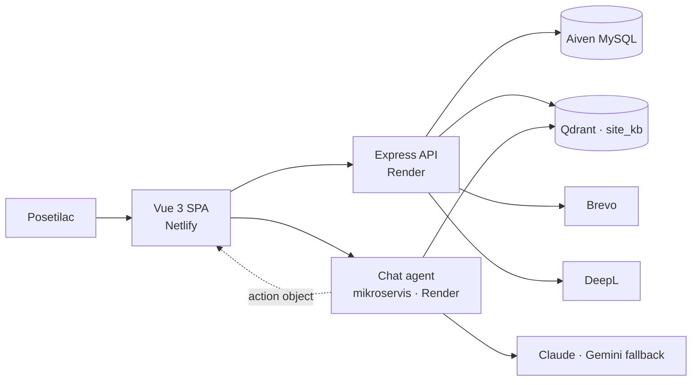

# Nastavna baza Goč

Web platforma [Šumarskog fakulteta Univerziteta u Beogradu](https://www.sfb.bg.ac.rs/) za nastavnu bazu na Goču: dvojezični javni sajt, CMS za uređivanje sadržaja, portal za goste i AI chat agent kao poseban mikroservis.

**[Otvori sajt](https://nastavnabazagoc.netlify.app)** · CMS: `/admin/login`

[](https://vuejs.org/)
[](https://vite.dev/)
[](https://expressjs.com/)
[](https://www.aiven.io/)
[](https://www.netlify.com/)
[](https://render.com/)

> English: bilingual teaching-base website with a CMS, guest portal, accommodation inquiries, and a standalone AI chat agent that never writes to the site database directly.

---

## Šta je ovaj projekat

Nastavna baza Goč nije statičan prezentacioni sajt. Ima tri jasno odvojena dela:

| Deo | Šta radi | Gde živi |
|-----|----------|----------|
| **Javni sajt** | Početna, smeštaj, restoran, vesti, edukacija, istraživanje, „Istraži Goč“, kontakt. Jezik `sr` / `en`. | ovaj repo → `frontend/` |
| **CMS** | Uređivanje stranica, vesti, soba, menija, osoblja, tema, rezervacija i CRM-a. DeepL pomaže prevod SR → EN. | ovaj repo → `/admin` |
| **Chat agent** | Razgovor sa posetiocem (RAG + alati). Predlaže akcije; sajt ih izvršava. | **poseban mikroservis**, nije u ovom repou |

Backend u ovom repou (`backend/`) je API sajta: sadržaj, rezervacije, gosti, mejlovi, keš. Chat agent je odvojen servis na Renderu (`chat-agent-kbjc.onrender.com`) i sa sajtom komunicira preko HTTP/SSE.

---

## Arhitektura

Sistem je namerno podeljen na **glas** i **ruke**. Agent razgovara i predlaže šta da se uradi. Sajt otvara forme, upisuje u bazu i šalje mejlove. Agent nikad ne piše direktno u MySQL sajta.



**Glas (agent):** pretražuje bazu znanja, vodi razgovor, šalje `action` (npr. otvori formu rezervacije, prepopuni polja).

**Ruke (sajt):** Vue widget (`AgentChatWidget`) izvršava akciju, API snima upit, šalje obaveštenja, vodi nalog gosta.

Isti obrazac se može preneti na drugi domen: nova persona, novi alati, nova baza znanja u Qdrantu.

---

## CMS — rukovanje sajtom

Administratori ulaze na **`/admin/login`**. Panel je JWT-zaštićen i pokriva sadržaj i operativu smeštaja.

**Sadržaj**

- vesti i statičke stranice
- osoblje i projekti
- teme „Istraži Goč“
- restoran (meni)
- hero slajdovi i podešavanja sajta
- dvojezični unos (`sr` / `en`) sa diskretnim dugmetom **SR → EN** (DeepL)

**Smeštaj i gosti**

- upiti i rezervacije (odobri / odbij / otkaži)
- mapa i uređivanje soba
- CRM gostiju i vaučeri lojalnosti
- otkazivanje je dozvoljeno samo ako ima najmanje 7 dana do check-in-a

**Ostalo**

- pregled AI potrošnje
- ručno čišćenje keša javnog sajta

Sadržaj koji se sačuva u CMS-u odmah ide u javni sajt (posle keša). Nije potreban redeploy zbog teksta, vesti ili menija.

---

## Chat agent — mikroservis

Widget na javnom sajtu šalje poruke na `POST /api/chat/stream` (SSE). Agent nije ugrađen u Express API ovog repoa.

- **Primarni model:** Claude (visoka preciznost, alati)
- **Fallback:** Gemini, isti set alata ako primarni model nije dostupan
- **Znanje:** Qdrant kolekcija `site_kb` (RAG)
- **Istorija:** poruke se mogu čuvati na API-ju sajta (`chat_messages`), vezane za gosta ili sesiju
- **Rezervacija iz chata:** agent predlaže akciju; forma na sajtu je izvor istine

Frontend URL agenta: `VITE_CHAT_API_URL` (lokalno ili produkcioni Render endpoint).

---

## Javni sajt i portal za goste

**Javno:** početna, smeštaj (lista + soba), restoran, vesti, edukacija, istraživanje, FAQ, Istraži Goč, kontakt. Jezik se menja globalno; CMS drži prevode u `*_translations` tabelama.

**Gost** (`/prijava`, `/moj-nalog`):

- nalog se kreira automatski kad gost pošalje prvi upit
- pregled rezervacija i statusa
- izmena lozinke, vaučeri na sajtu (namerno nisu u mejlu — vraćaju posetioce)
- mejlovi za prijem upita, odobrenje i odbijanje (Brevo)

---

## Tehnologije i hosting

| Sloj | Stack | Hosting |
|------|--------|---------|
| Frontend | Vue 3, Vite, Pinia, Vue Router | **Netlify** (SPA, `_redirects`) |
| API sajta | Node.js, Express 5, mysql2, JWT, Joi, Multer | **Render** |
| Baza | MySQL | **Aiven** |
| Chat agent | zaseban Node servis, SSE | **Render** |
| Vektori | Qdrant | cloud |
| Mejl | Nodemailer / Brevo | Brevo |
| Prevod | DeepL (`POST /api/admin/translate`) | DeepL API |

Produkcija se deploy-uje sa grane `main` (GitHub → Netlify + Render). Lokalni i produkcioni API dele istu Aiven bazu kada je tako podešen `.env`.

---

## Struktura repozitorijuma

```
frontend/            Vue 3 SPA (javni sajt, CMS, portal gosta, chat widget)
backend/             Express API, migracije, seed, Qdrant seed
01-organized-docs/   Interna dokumentacija (kontekst, arhitektura, changelog)
```

Chat agent **nije** deo ovog monorepoa. Ovaj repo šalje zahteve na URL mikroservisa.

---

## Brzi start

Potreban **Node** v20.19+ ili ≥22.12.

### Frontend

```bash
cd frontend
cp .env.example .env
# VITE_API_BASE_URL=http://127.0.0.1:3000
# VITE_CHAT_API_URL=<lokalni ili produkcioni agent>
npm install
npm run dev
```

### Backend

```bash
cd backend
cp .env.example .env   # baza, JWT, Brevo, DeepL, Qdrant…
npm install
npm run dev            # Windows: oslobađa port 3000, zatim server.js
```

Korisne skripte u `backend/package.json`: `migrate:dry` / `migrate:run`, smoke testovi, `seed:site-kb`.  
**Ne pokretati** `db:init:*`, `db:seed:presentation:*` ni `restart-site*` na produkcionoj bazi.

Detaljnije: [`frontend/README.md`](frontend/README.md), [`01-organized-docs/`](01-organized-docs/).

---

## Licenca

Privatni projekat Šumarskog fakulteta Univerziteta u Beogradu. Nije otvoren za javni fork bez dogovora sa naručiocem.
